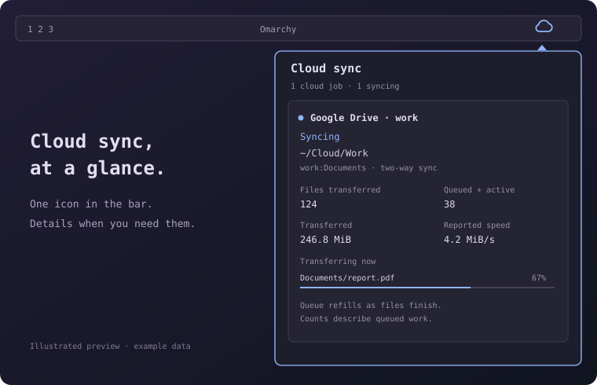

# Cloud Sync Status

[](https://github.com/cjvnjde/cloud-sync-status/actions/workflows/checks.yml)
[](LICENSE)

A read-only [Omarchy](https://omarchy.org/) bar plugin for **rclone**. Keep a
small colored cloud icon in the top bar and open a detailed per-cloud popup
when you need to see what is happening.



*Illustrated preview with example data. Colors and sizing follow your Omarchy theme.*

## Install

Requires Omarchy 4 with the Quickshell plugin system, Python **3.10+**, and
existing rclone jobs. There are no third-party Python dependencies.

```bash
omarchy plugin add https://github.com/cjvnjde/cloud-sync-status.git --enable
```

The widget appears on the right. To move it:

```bash
omarchy bar move cjvnjde.cloud-sync-status --section left
```

Update, disable, or remove it with the normal Omarchy commands:

```bash
omarchy plugin update cjvnjde.cloud-sync-status
omarchy plugin disable cjvnjde.cloud-sync-status
omarchy plugin remove cjvnjde.cloud-sync-status
```

Disabling or removing the widget leaves your sync services and files untouched.

## What it shows

The top bar is always **icon-only**. Click the icon to open the popup.

| Icon color | Meaning |
| --- | --- |
| Theme accent | A sync or scan is running |
| Green | The latest bisync succeeded and its timer is active |
| Red | A job failed or status is unavailable |
| Muted | Inactive, unmonitored, or on-demand mount |

Each cloud can show:

- Cloud/remote name, local folder, and remote path.
- Scan phase, elapsed run time, and last successful check.
- Verified local/cloud item counts when saved bisync inventories are available.
- Completed transfers, queued work, transferred bytes, speed, and queue ETA.
- Current files with individual progress bars, the last transferred file, and errors.

Available data depends on the job and how it reports progress. Values refresh
every **five seconds**. The widget monitors existing jobs; create and configure
sync jobs with your usual rclone/systemd workflow.

## Job discovery and live progress

The collector finds running `rclone bisync`, `sync`, `copy`, `mount`, `cmount`,
and `nfsmount` processes owned by your user. Recent user-systemd journal entries
keep completed or failed services visible. Configured remotes without a detected
job appear as **No sync job detected**. Mounts are labelled as on-demand mounts.

For live bytes, speed, and per-file progress, add a loopback RC endpoint to your
**existing** rclone command/service:

```bash
--rc --rc-addr=127.0.0.1:5572
```

Use a different port for each simultaneous job. The plugin discovers the port
from the process arguments and reads only `core/stats`. If RC is absent or
requires authentication, it falls back to available journal information.
See the [rclone RC documentation](https://rclone.org/rc/).

Jobs running in a user systemd service provide journal history and timer state.
One rclone job per service is supported. Standalone processes can be monitored
while running; without RC their detailed progress is unavailable.

## Reading the numbers

**Queued + active is a queue, not a full remaining-file count.** Rclone refills
its bounded queue as work finishes. A queue can stay at the same number while
the completed count and downloaded bytes keep increasing. Queued bytes and
**Queue ETA** cover that same work; no overall completion percentage is inferred.

**A scan can take time without changing the counters.** The widget shows its
phase and elapsed run time instead of treating rclone's internal comparison
counter as progress through all files. This matters for large encrypted folders.

**Verified inventory comes from the last successful bisync.** With an explicit,
dedicated `--workdir`, matching local listing files supply local/cloud entry
counts, including files and folders. Ambiguous or stale inventories are omitted.
These counts do not trigger an additional cloud scan.

Counts reset for each systemd invocation. A `≥` prefix indicates limited log
history. Missing metrics show `—` or **Not reported**. A green icon reflects the
last successful scheduled bisync, not a continuous check against the cloud.

## Privacy and permissions

The plugin reads your own process metadata, user-systemd status/journal,
local bisync listing files, and optional loopback RC statistics. Rclone configs
are read only to map remote names to provider types. Passwords and tokens are
not included in collector output.

It never starts/stops sync jobs, edits rclone configuration, or sends requests
to a cloud provider. Local RC requests ignore proxy settings and do not follow
redirects. Monitoring a job does not require giving the plugin cloud credentials.

Provider labels use `RCLONE_CONFIG`, `XDG_CONFIG_HOME/rclone/rclone.conf`, the
usual `~/.config/rclone/rclone.conf`, or a legacy `~/.rclone.conf` fallback.
Explicit `--config` paths are supported for job provider labels. Encrypted
configs are not decrypted; detected jobs still appear with their remote names.

## Troubleshooting

| Symptom | Check |
| --- | --- |
| No clouds detected | Confirm rclone is running as your user and its command is supported. |
| Cloud appears without a job | Start your existing sync service; the plugin does not schedule jobs. |
| Missing speed or file progress | Check the job's loopback RC endpoint; authenticated RC falls back to logs. |
| Old job is missing | Discovery searches the latest 250 rclone journal entries. |
| Scanning for a long time | Check rclone's logs; large provider listings can be slow. |
| Edits do not appear | Run `omarchy restart shell` to clear cached QML components. |

The collector can be inspected locally:

```bash
python3 ~/.config/omarchy/plugins/cjvnjde.cloud-sync-status/status.py
```

Its JSON contains remote names and file paths. Redact those before sharing it.
Other sync clients, including rsync and Syncthing, are outside this plugin's scope.

## Development

```bash
git clone https://github.com/cjvnjde/cloud-sync-status.git
cd cloud-sync-status
python3 -m unittest discover -s tests -v
python3 -m py_compile status.py
omarchy plugin validate .
```

The collector tests and manifest checks run without an Omarchy session. QML
and visual checks require the installed shell. Tested locally with Omarchy
4.0.6, rclone 1.75.2, and Python 3.14; CI covers Python 3.10, 3.12, and 3.14.
See [CONTRIBUTING.md](CONTRIBUTING.md) for the development workflow.

## License

[MIT](LICENSE) © 2026 cjvnjde.
